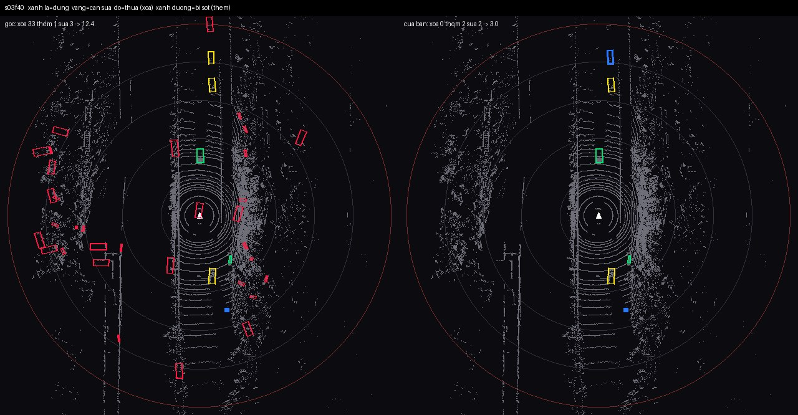

# Báo cáo Day 14 — Trịnh Đức Hưng — 2A202603177

- Mã học viên dùng với `--student`: `2A202603177`
- `seed_tag` trong `frames_A.txt`: `82ac3100fd`

## 1. Dự đoán trước sweep (bước 5b)

Ghi **trước** khi chạy `scripts/pp_sweep.py`, rồi commit và push ngay (lịch sử commit là bằng chứng thời điểm viết). Không sửa phần này sau khi có kết quả.

- Tham số tôi nghĩ giảm công sửa nhiều nhất: **`score_thr`**, tăng từ 0.1 lên khoảng **0.4** (giữ `min_points=0`). Tôi nghĩ `min_points` gần như không đổi kết quả.
- Vì sao (nhìn ảnh BEV tập A: box thừa nhiều hay box sót nhiều?):
  - Tập A thừa box nhiều hơn sót box rất nhiều. Cấu hình gốc dự đoán 83 box, nhãn sửa tay chỉ có 44. Số đo: **xóa 54, thêm 15, sửa 14 → chi phí 38.2**. Riêng s03f40 phải xóa 33 box. Ảnh `png_A/s03f40.jpg` (BEV và 7 camera) cho thấy khoảng 16 `Cyclist` và nhiều `Car` đặt dọc hai mép đường. Trên camera, các box này nằm trên bụi cây, dải cây xanh và lan can, không phải xe thật.
  - Các box tôi xóa có `score` thấp hơn hẳn các box tôi giữ: trung vị khoảng 0.31, so với 0.86 ở box giữ. Gần như toàn bộ `Cyclist` thừa ở s03f40 có `score` từ 0.21 đến 0.48. Đặt ngưỡng 0.4 sẽ bỏ khoảng 37 box thừa (−11.1 chi phí, mỗi box 0.3), nhưng làm mất khoảng 3 box đúng (+3.0, mỗi box sót 1.0). Như vậy chi phí giảm khoảng 8, từ 38.2 xuống khoảng 30. Ngưỡng 0.5 bỏ thêm box thừa nhưng cũng mất thêm box đúng, nên tôi đoán mức lợi gần bằng 0.4.
  - `min_points` không giúp được: chỉ 1 box thừa có dưới 10 điểm LiDAR. Box thừa vẫn có trung vị khoảng 40 điểm, vì chúng nằm trên vật thật, chỉ bị gán sai lớp. Vì vậy lọc theo số điểm ở mức 5 hoặc 10 gần như không bỏ được box nào.
  - Rủi ro: 15 box cần thêm (14 ở s01f25) là vật mô hình bỏ sót hẳn. Tăng `score_thr` không sửa được nhóm này, và nếu đặt ngưỡng quá cao thì sẽ có thêm box bị sót.

## 2. Tập A: sửa tay và tune

| Cấu hình | Xóa | Thêm | Sửa | Chi phí |
|---|---:|---:|---:|---:|
| Gốc | 54 | 15 | 14 | 38.2 |
| `best_config.json` | 7 | 19 | 10 | 26.1 |

Chi phí từng frame (từ `d14_2A202603177/sweep.csv`):

| Cấu hình | s01f25 | s03f40 | s04f45 |
|---|---:|---:|---:|
| Gốc (`score_thr=0.1`, `min_points=0`) | 21.7 | 12.4 | 4.1 |
| `score_thr=0.4`, `min_points=0` | 21.0 | 4.2 | 2.6 |
| `best_config.json` (`score_thr=0.5`, `min_points=0`) | 19.8 | 3.0 | 3.3 |

- Tham số đã đổi trong `best_config.json`: `score_thr` 0.1 → **0.5**. `min_points` vẫn là **0**, các tham số khác giữ nguyên. Tổng chi phí giảm 38.2 → 26.1 (−12.1, khoảng −32%). Số box phải xóa giảm 54 → 7, đổi lại số box phải thêm tăng 15 → 19.
- Kết quả leave-one-out (dán các dòng `scripts/pp_sweep.py` in ra):

  ```
  s01f25: cấu hình chọn {'score_thr': '0.5', 'min_points': '0'} → 19.8 (tốt nhất có thể 19.8)
  s03f40: cấu hình chọn {'score_thr': '0.5', 'min_points': '0'} → 3.0 (tốt nhất có thể 3.0)
  s04f45: cấu hình chọn {'score_thr': '0.5', 'min_points': '0'} → 3.3 (tốt nhất có thể 2.6)
  ```

- Cấu hình có ổn định trên từng frame không? Vì sao tôi vẫn chọn (hoặc không chọn) nó:
  - **Khá ổn định, nên tôi chọn nó.** Cả 3 lượt leave-one-out đều chọn cùng cấu hình `score_thr=0.5, min_points=0`. Ở s01f25 và s03f40, chi phí trên frame bỏ ra bằng đúng `oracle`.
  - **Chỉ lệch ở s04f45:** 3.3 so với `oracle` 2.6, do ngưỡng 0.4 tốt hơn ở frame này. Ở ngưỡng 0.5, frame này mất thêm box đúng, nên số box phải thêm tăng. Mức lệch 0.7 nhỏ hơn nhiều so với 12.1 điểm giảm được trên toàn tập A.
  - **`min_points` gần như không có tác dụng:** ở cùng `score_thr`, chi phí chênh tối đa 0.3. Box thừa đều có nhiều điểm LiDAR.
  - **Hạn chế:**
    - Tập A chỉ có 3 frame.
    - 0.5 là mức cao nhất của lưới, nên ngưỡng tốt nhất có thể còn cao hơn.
    - Phần lớn chi phí còn lại là box sót: thêm 19 box, trong đó s01f25 chiếm 19.8 điểm chi phí. Tăng ngưỡng không sửa được loại lỗi này. Nếu ngưỡng tăng tiếp, số box sót có thể tăng nhanh hơn số box thừa giảm, nên tôi dừng ở 0.5.

## 3. Trước/sau (bước 8)



*Ảnh s03f40: bên trái là cấu hình gốc (xóa 33, thêm 1, sửa 3 → 12.4), bên phải là `best_config.json` (xóa 0, thêm 2, sửa 2 → 3.0).*

- `scripts/pp_compare.py` báo **giảm 32%** công sửa trên tập A (38.2 → 26.1), với `score_thr` 0.1 → 0.5:

  | Frame | Chi phí gốc | `best_config.json` |
  |---|---:|---:|
  | s01f25 | 21.7 | 19.8 |
  | s03f40 | 12.4 | 3.0 |
  | s04f45 | 4.1 | 3.3 |
  | **Tổng** | **38.2** | **26.1** |

- Dự đoán ở mục 1 đúng hay sai? Giải thích bằng số box xóa/thêm/sửa:
  - **Đúng về hướng và tham số.** Tăng `score_thr` là thay đổi giảm công sửa nhiều nhất. `min_points` gần như vô tác dụng: ở cùng `score_thr`, chi phí chỉ chênh tối đa 0.3.
  - **Ước lượng cho ngưỡng 0.4 khá sát:**
    - Tôi đoán bỏ được khoảng 37 box thừa; thực tế số box phải xóa giảm 54 → 16, tức bớt 38.
    - Tôi đoán mất khoảng 3 box đúng; thực tế số box phải thêm tăng 15 → 17, tức mất 2.
    - Chi phí thực tế ở 0.4 là 27.8, thấp hơn mức khoảng 30 tôi đoán.
  - **Sai ở mức ngưỡng tốt nhất:** đó là 0.5 (26.1) chứ không phải 0.4. Tôi đã đoán 0.5 "gần bằng" 0.4, nhưng thực tế 0.5 tốt hơn 1.7.
    - Ở 0.5, số box phải xóa còn 7 (−47 so với gốc, tức −14.1 chi phí).
    - Đổi lại, số box phải thêm tăng 15 → 19 (+4.0).
    - Số box phải sửa giảm 14 → 10, vì nhiều box thừa bị lệch đã bị loại luôn.
  - **Trong ảnh s03f40:** gần như toàn bộ box đỏ (thừa) dọc hai mép đường (bụi cây, lan can) biến mất. Cái giá phải trả là một box xe ở phía trước xa: ở cấu hình gốc nó chỉ cần sửa (vàng), nhưng ở 0.5 bị lọc mất nên thành box sót (xanh dương). Đây đúng là rủi ro tôi đã nêu ở mục 1.
  - **Chi phí còn lại chủ yếu là box sót.** s01f25 chỉ giảm 21.7 → 19.8, vì vật bị sót ở frame này không có box dự đoán nào để lọc.

## 4. Tập B

Số đo từ `scripts/pp_prelabel.py --frames d14_2A202603177/frames_B.txt --config d14_2A202603177/best_config.json --gt d14_2A202603177/ref_B.json`:

| Xóa | Thêm | Sửa | Chi phí |
|---:|---:|---:|---:|
| 39 | 38 | 38 | 68.7 |

`ref_B.json` có 147 cuboid trên 12 frame: Car 113, Cyclist 15, Truck 9, Bus 6, Pedestrian 5. `pred_B.json` có 148 box, trong đó 109 box khớp với nhãn đã sửa.

Để đối chiếu, tôi chạy thêm cấu hình gốc (`score_thr=0.1`) trên cùng `ref_B.json`. Kết quả: dự đoán 341 box, **xóa 225, thêm 31, sửa 45 → chi phí 121.0**. Như vậy `best_config.json` giảm **43%** công sửa trên tập B (121.0 → 68.7), còn nhiều hơn mức 32% trên tập A. Cấu hình chọn trên 3 frame A vẫn có tác dụng trên 12 frame mới thuộc 4 sequence.

| Frame | Xóa | Thêm | Sửa | Chi phí |
|---|---:|---:|---:|---:|
| s02f03 | 3 | 2 | 0 | 2.9 |
| s02f28 | 3 | 2 | 3 | 4.4 |
| s02f46 | 4 | 3 | 0 | 4.2 |
| s03f09 | 4 | 4 | 0 | 5.2 |
| s03f31 | 4 | 1 | 1 | 2.7 |
| s03f53 | 3 | 3 | 2 | 4.9 |
| s04f08 | 5 | 3 | 4 | 6.5 |
| s04f35 | 1 | 2 | 7 | 5.8 |
| s04f53 | 1 | 2 | 6 | 5.3 |
| s05f00 | 8 | 1 | 3 | 4.9 |
| s05f23 | 2 | 5 | 1 | 6.1 |
| s05f43 | 1 | 10 | 11 | **15.8** |

- Loại box tốn công sửa nhất ở tập B: **vật bị sót, nhất là Truck, Bus và Pedestrian.**
  - Ở cấu hình gốc, chi phí chủ yếu đến từ việc xóa (225 box). Sau khi tune, số box phải thêm (38, mỗi box 1.0) chiếm 38/68.7 ≈ 55% chi phí.
  - Tôi đối chiếu `ref_B.json` với `pred_B.json` theo khoảng cách tâm (≤ 2 m). Kết quả ước tính: box phải vẽ mới gồm khoảng 10 Car, 8 Truck, 7 Cyclist, 6 Bus, 5 Pedestrian.
  - Mô hình KITTI không có lớp Truck/Bus và rất yếu với Pedestrian. Vì vậy gần như toàn bộ Truck, Bus và Pedestrian phải vẽ tay.   - Khoảng một nửa số box bị sót (17/36 theo ước tính) nằm ở xa, khoảng 33–50 m, nơi đám mây điểm thưa.
  - **s05f43 là frame tốn nhất (15.8):** thêm 10 và sửa 11. Frame này có 25 vật, gồm 5 Truck và 1 Bus, nhưng mô hình chỉ ra 15 box `Car`.
  - Box thừa còn lại (39) chủ yếu là `Car` và `Cyclist` trên bụi cây và lan can mép đường, giống tập A. Ví dụ s05f00 vẫn phải xóa 8 box.

## 5. Giới hạn

1. **Chỉ tune trên 3 frame.** `best_config.json` được chọn từ 3 frame A, và chỉ thử 1 tham số có tác dụng (`score_thr`). Mức tốt nhất 0.5 nằm ở biên lưới, nên có thể bỏ lỡ một ngưỡng tốt hơn. Leave-one-out trên 3 frame cũng chỉ cho tín hiệu yếu. Ví dụ ở s04f45, ngưỡng 0.4 lại tốt hơn 0.5.
2. **Một ngưỡng chung cho mọi lớp.** Box thừa chủ yếu là `Cyclist` và `Car` ở mép đường, còn box đúng ở xa cũng có `score` thấp. Đặt `score_thr=0.5` cho tất cả các lớp vừa bỏ được box thừa, vừa làm mất box đúng: trên tập A, số box phải thêm tăng 15 → 19. Ngưỡng riêng theo lớp (`thr_car`, `thr_cyc`, `thr_ped` có sẵn trong config nhưng tôi chưa quét) có thể cân bằng tốt hơn.
3. **Mô hình KITTI không có lớp Truck/Bus và yếu với Pedestrian.** Hậu xử lý chỉ lọc được box thừa, không tạo ra được box cho vật mô hình không phát hiện. Đây là phần chi phí lớn nhất còn lại trên tập B (thêm 38 box). Muốn giảm thêm phải fine-tune mô hình trên dữ liệu VF, không thể chỉ chỉnh ngưỡng.
4. **Chi phí là công thức, không phải thời gian sửa thật.** Mỗi box xóa tính 0.3, mỗi box sửa 0.5, mỗi box thêm 1.0. Thực tế, vẽ một xe tải ở 45 m tốn thời gian hơn nhiều so với xóa một box trên bụi cây. Việc ghép box theo ngưỡng khớp cũng có thể tính một box lệch nhẹ là "sửa" dù người gán nhãn có thể để nguyên.
5. **Nhãn tham chiếu do chính tôi sửa, một người, một lượt.** Nhãn tham chiếu có thể còn sai, nhất là vật ở xa hoặc bị che. Chi phí "đúng" vì thế phụ thuộc vào cách tôi sửa nhãn.
